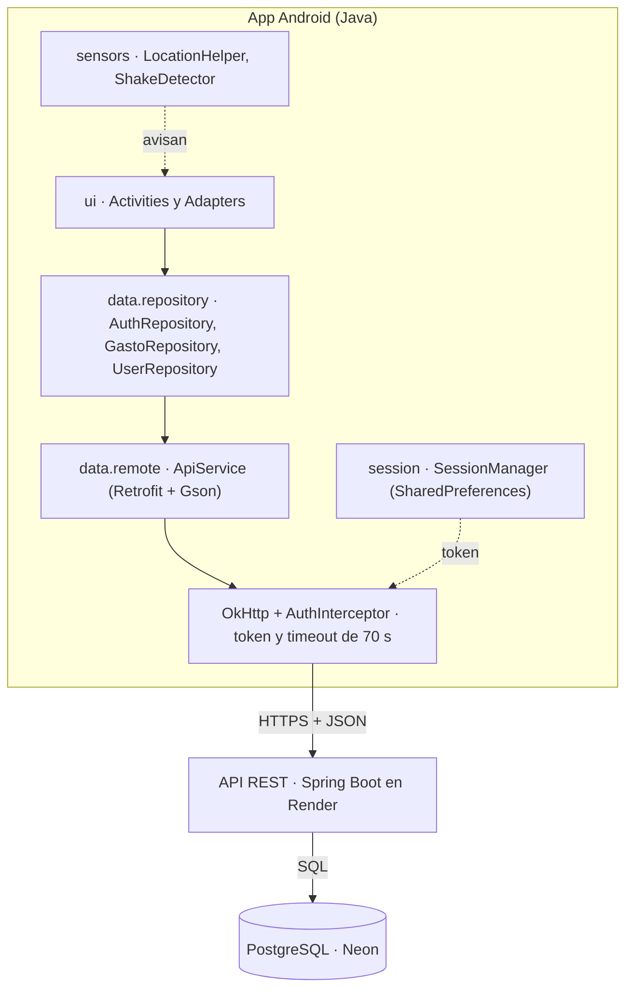

<p align="center">
  
</p>

<p align="center"><b>Tu dinero, bajo control. ¡Empieza hoy!</b></p>

# Oye! · App Android nativa (Corte 3)

Aplicación móvil para registrar y organizar **gastos con IVA**, hecha en **Android Studio con Java**.
Guarda todo en una **API REST en la nube** (Spring Boot en Render + PostgreSQL en Neon) y usa
**dos sensores** del celular: la **ubicación** para llenar el lugar del gasto y el **acelerómetro**
para recargar la lista al agitar el celular.

---

## Datos de la entrega

| | |
|---|---|
| Estudiante | Gary José Castaño Molina |
| Código | 7502420050 |
| Correo institucional | gcastanom@unicartagena.edu.co |
| Asignatura | Desarrollo de Apps · Universidad de Cartagena |
| Ejercicio asignado | 6 · Gastos |
| Actividad | Corte 3: Android Studio (Java) con persistencia en API REST y 2 sensores |
| APK | [`apk/oye.apk`](apk/oye.apk) |
| API REST en producción | https://oye-api-j5l4.onrender.com |
| Documentación de la API (Swagger) | https://oye-api-j5l4.onrender.com/swagger-ui/index.html |
| Repositorio del backend | https://github.com/gary-castano-m/users-management-spring-boot-hexagonal-ddd |
| Video de sustentación | _ENLACE_DEL_VIDEO_ |

> La API corre en el plan gratuito de Render. Si lleva un rato sin uso, la primera petición tarda
> hasta un minuto mientras el servidor despierta. La app lo tiene en cuenta: el splash hace esa
> primera petición y todas las peticiones esperan hasta 70 segundos.

---

## Contenido

1. [Qué hace la app](#1-qué-hace-la-app)
2. [Del Corte 2 al Corte 3](#2-del-corte-2-al-corte-3)
3. [Requisitos del enunciado](#3-requisitos-del-enunciado)
4. [Arquitectura](#4-arquitectura)
5. [Pantallas](#5-pantallas)
6. [Los dos sensores](#6-los-dos-sensores)
7. [Endpoints que consume la app](#7-endpoints-que-consume-la-app)
8. [Tecnologías](#8-tecnologías)
9. [Instalar el APK](#9-instalar-el-apk)
10. [Compilar desde el código fuente](#10-compilar-desde-el-código-fuente)
11. [Estructura del proyecto](#11-estructura-del-proyecto)
12. [Historial de desarrollo](#12-historial-de-desarrollo)

---

## 1. Qué hace la app

- **Cuenta:** registro, inicio de sesión con usuario o correo, recuperación de la contraseña por correo
  y edición del perfil propio.
- **Gastos:** registrar, listar, editar y eliminar gastos. Cada gasto tiene fecha, valor sin IVA, lugar
  y descripción; el **IVA del 19 %** y el total los calcula la API. Mientras se escribe el valor, la app
  muestra una vista previa del IVA.
- **Reportes de gastos:** por rango de fechas y por lugar, con la cantidad y los totales.
- **Administración (solo ADMIN):** crear, editar (rol y estado) y eliminar usuarios; reportes de
  usuarios por rol y por nombre.
- **Roles:** `MEMBER` ve solo sus gastos; `REVIEWER` ve todos; `ADMIN` ve y administra todo.

## 2. Del Corte 2 al Corte 3

El backend es **el mismo** del Corte 2, sin cambios. Lo que cambió es el cliente: la app de Kodular
se rehízo como una app nativa de Android en Java.

| | Corte 2 · Kodular | Corte 3 · Android Studio |
|---|---|---|
| Lenguaje | Bloques | Java |
| Pantallas | Screens + Diseñador | Activities + layouts XML (Material 3) |
| Peticiones HTTP | Componente Web | Retrofit + OkHttp |
| JSON | `JSON Text Decode` + `look up in pairs` | Gson + clases modelo |
| Token en cada petición | Procedimiento `encabezados` en cada pantalla | Un solo `AuthInterceptor` para toda la app |
| Sesión | TinyDB | SharedPreferences (`SessionManager`) |
| Listas | ListView | RecyclerView + Adapter |
| Sensores | LocationSensor, AccelerometerSensor | FusedLocationProviderClient + Geocoder, SensorManager |

Las dos apps usan la misma API y la misma base de datos: un gasto creado en una aparece en la otra.

## 3. Requisitos del enunciado

| Requisito | Cómo se cumple |
|---|---|
| Android Studio (Java o Kotlin) | Java, Activities y layouts XML |
| Persistencia en API REST en la nube | Backend Spring Boot en Render ([repositorio](https://github.com/gary-castano-m/users-management-spring-boot-hexagonal-ddd)) |
| BD relacional gratuita en internet | PostgreSQL en Neon |
| CRUD de la tabla Usuario | `UsuariosActivity` + `UsuarioFormActivity` (ADMIN) |
| CRUD de la tabla Gastos | `GastosListActivity` + `GastoFormActivity` |
| 2 reportes parametrizados de Usuario | `ReporteUsuariosActivity`: por rol y por nombre |
| 2 reportes parametrizados de Gastos | `ReporteGastosActivity`: por rango de fechas y por lugar |
| Login | `LoginActivity` con token JWT |
| Recordatorio de clave por email | Diálogo en el login → `POST /api/auth/forgot-password` (correo por Brevo) |
| Al menos 2 sensores | Ubicación y acelerómetro ([sección 6](#6-los-dos-sensores)) |
| Código fuente y APK en GitHub | Este repositorio y [`apk/oye.apk`](apk/oye.apk) |

## 4. Arquitectura

La app se organiza en capas. Cada pantalla le pide a un repositorio; el repositorio usa `ApiService`
(Retrofit), y `AuthInterceptor` agrega el token antes de que la petición salga hacia Render.



Las respuestas llegan a la pantalla a través de la interfaz `Resultado<T>` (`onExito` / `onError`).
`ApiCallback` revisa el código HTTP y convierte los errores en mensajes en español.

## 5. Pantallas

| Pantalla | Qué hace | En Kodular era |
|---|---|---|
| `SplashActivity` | Logo y lema. Despierta el servidor; si hay sesión guardada, la verifica con `/api/users/me` y entra directo al menú | Screen1 |
| `LoginActivity` | Inicio de sesión con usuario o correo; diálogo para recuperar la contraseña | Screen2 |
| `RegisterActivity` | Registro con validación en el celular; avisa si el usuario o el correo ya existen | Screen3 |
| `MenuActivity` | Saludo y rol; la sección *Administración* solo aparece para ADMIN | Screen4 y Screen5 |
| `GastoFormActivity` | Crear o editar un gasto; fecha con calendario; vista previa del IVA; **sensor de ubicación** | Screen6 |
| `GastosListActivity` | Lista de gastos con total; editar o eliminar; **agitar para recargar** | Screen7 |
| `PerfilActivity` | Editar los datos propios; contraseña vacía = no se cambia | Screen8 |
| `ReporteGastosActivity` | Reporte por rango de fechas o por lugar, con totales | Screen9 y Screen10 |
| `UsuariosActivity` + `UsuarioFormActivity` | CRUD de usuarios (ADMIN) | Screen11 |
| `ReporteUsuariosActivity` | Reporte de usuarios por rol o por nombre | Screen12 y Screen13 |

## 6. Los dos sensores

| Sensor | Clase | Dónde se usa | Cómo funciona |
|---|---|---|---|
| **Ubicación** | `sensors/LocationHelper` | Formulario de gasto | Pide el permiso en tiempo de ejecución, toma **una** lectura con `FusedLocationProviderClient.getCurrentLocation` y la convierte en dirección con `Geocoder`. Llena el campo *Lugar* solo si está vacío; el ícono 📍 del campo lo vuelve a pedir. |
| **Acelerómetro** | `sensors/ShakeDetector` | Lista de gastos | `SensorManager` + `SensorEventListener`. Calcula la fuerza total en g; por encima de **2,5 g** se considera un agitón (con 1,5 s de espera entre agitones) y la lista se vuelve a pedir a la API. Se registra en `onResume` y se libera en `onPause`. |

## 7. Endpoints que consume la app

| Método | Ruta | Uso |
|---|---|---|
| POST | `/api/auth/login` | Iniciar sesión (usuario o correo) |
| POST | `/api/auth/register` | Crear cuenta (rol MEMBER) |
| POST | `/api/auth/forgot-password` | Enviar contraseña temporal por correo |
| GET / PUT | `/api/users/me` | Ver y editar el perfil propio |
| GET / POST | `/api/gastos` | Listar y registrar gastos |
| GET / PUT / DELETE | `/api/gastos/{id}` | Consultar, editar y eliminar un gasto |
| GET | `/api/gastos/reports?desde=&hasta=` · `?lugar=` | Reportes de gastos |
| GET / POST | `/api/users` | Listar y crear usuarios (ADMIN) |
| PUT / DELETE | `/api/users/{id}` | Editar y eliminar usuarios (ADMIN) |
| GET | `/api/users/reports?role=` · `?name=` | Reportes de usuarios |
| GET | `/v3/api-docs` | Despertar el servidor desde el splash |

Todas las rutas, salvo las de `/api/auth` y `/v3/api-docs`, llevan el encabezado
`Authorization: Bearer <token>`.

## 8. Tecnologías

| Tecnología | Para qué |
|---|---|
| Android Studio, Java | Desarrollo de la app |
| AndroidX AppCompat, Material Components 3 | Pantallas, tema y componentes |
| RecyclerView | Listas de gastos y usuarios |
| Retrofit 2.11 + Gson | Peticiones a la API y conversión de JSON |
| OkHttp logging-interceptor 4.12 | Registro básico de peticiones en Logcat (sin el token) |
| Google Play Services Location 21.3 | Sensor de ubicación |
| SensorManager (Android) | Acelerómetro |
| Fuente Poppins Bold | Títulos y lema de la marca |

Versión mínima de Android: **7.0 (API 24)**.

## 9. Instalar el APK

1. Descarga [`apk/oye.apk`](apk/oye.apk) en el celular. En GitHub: abre el archivo y toca **Download raw file**.
2. Ábrelo. Si Android lo pide, permite **instalar aplicaciones de origen desconocido** para el navegador o el gestor de archivos.
3. Abre **Oye!**: el splash despierta el servidor y luego aparece el login.
4. Crea una cuenta con **Crear una cuenta**, o entra con un usuario existente.
5. Para el sensor de ubicación, acepta el permiso *Mientras se usa la app* y ten la ubicación encendida.

## 10. Compilar desde el código fuente

Requisitos: **Android Studio** reciente (trae su propio JDK) y conexión a internet.

```bash
git clone https://github.com/gary-castano-m/oye-android.git
```

1. En Android Studio: **File → Open** y elige la carpeta `oye-android`.
2. Espera a que termine la sincronización de Gradle.
3. Conecta un celular con la **depuración USB** activada (en Xiaomi, también *Instalar vía USB*) o crea un emulador.
4. Toca **▶ Run 'app'**.

Desde la terminal también se puede generar un APK de depuración:

```bash
./gradlew assembleDebug        # Linux / macOS
gradlew.bat assembleDebug      # Windows
```

El APK queda en `app/build/outputs/apk/debug/`. La dirección del backend está en
`app/src/main/java/com/gcastanom/oye/data/remote/ApiConfig.java`.

## 11. Estructura del proyecto

```text
app/src/main/
├── AndroidManifest.xml          permisos (internet, ubicación) y pantallas
├── java/com/gcastanom/oye/
│   ├── data/
│   │   ├── model/               clases de los JSON: Gasto, Usuario, LoginRequest, ReporteGastos…
│   │   ├── remote/              ApiConfig, ApiService, RetrofitClient, AuthInterceptor
│   │   └── repository/          AuthRepository, GastoRepository, UserRepository, ApiCallback, Resultado
│   ├── session/                 SessionManager
│   ├── sensors/                 LocationHelper (ubicación), ShakeDetector (acelerómetro)
│   └── ui/
│       ├── splash/  auth/  menu/  gastos/  perfil/  usuarios/  reportes/
│       └── Pantalla, Navegacion, Formato, Fechas, Etiquetas
└── res/
    ├── layout/                  diseño de cada pantalla
    ├── values/                  textos (strings.xml), colores y tema de la marca
    ├── drawable/ drawable-nodpi/ ícono, logos y recursos gráficos
    └── font/                    Poppins Bold
apk/oye.apk                      APK listo para instalar
```

## 12. Historial de desarrollo

Cada funcionalidad se hizo en su propia rama y entró a `main` por Pull Request.

| PR | Rama | Qué agregó |
|---|---|---|
| — | `main` | Proyecto vacío de Android Studio en Java |
| #1 | `feature/base-api` | Retrofit, modelos, `ApiService`, interceptor del token y sesión |
| #2 | `feature/auth` | Splash, login, registro, recuperar contraseña y menú |
| #3 | `feature/gastos` | CRUD de gastos con lista, formulario y vista previa del IVA |
| #4 | `feature/sensores` | Sensor de ubicación y acelerómetro |
| #5 | `feature/perfil-usuarios-reportes` | Mi perfil, CRUD de usuarios y los cuatro reportes |
| #6 | `feature/identidad-visual` | Ícono, colores, logo y lema de la marca |
| #7 | `docs/readme-apk` | Este README y el APK |

---

Gary José Castaño Molina · Universidad de Cartagena · Ingeniería de Software · 2026
